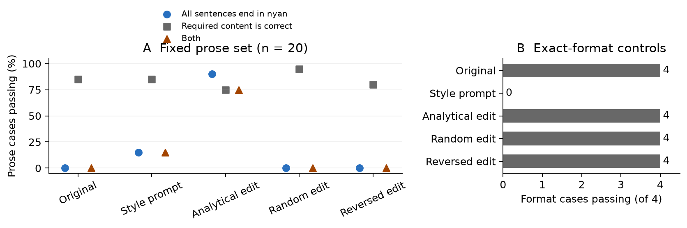

# Qwen Nyan Weight Edit

A reproducible experiment that edits Qwen3.5-0.8B to end Japanese answers
with **にゃん** (“nyan”), without a style instruction or output postprocessing
at inference time.

The working edit uses **supervised, closed-form parameter estimation**.
It uses neither backpropagation nor an optimizer, but it is not evidence of
training-free weight-space programming. The direct weight-arithmetic methods
tested here did not produce the requested behavior.

On 20 held-out prose questions, the edited model passed the sentence-ending
check on **18/20**, and both the content and style checks on **15/20**.
The original model passed the content check on **17/20**. Three originally
correct answers regressed; one originally failing answer improved.

| Condition | Nyan endings / 20 | Content / 20 | Both / 20 | Exact format / 4 |
| --- | ---: | ---: | ---: | ---: |
| Original | 0 | 17 | 0 | 4 |
| Style prompt | 3 | 17 | 3 | 0 |
| Analytical weight edit | 18 | 15 | 15 | 4 |
| Same-norm random edit | 0 | 19 | 0 | 4 |
| Reversed edit | 0 | 16 | 0 | 4 |



The [Japanese research report](REPORT.md) explains the method, exact tensor
changes, examples, failures, and evaluation limits. It is also available as
[PDF](REPORT.pdf) and [standalone HTML](REPORT.html).

## Try your own prompts

Install [uv](https://docs.astral.sh/uv/getting-started/installation/), then:

```bash
git clone https://github.com/tetsuya-dev-jp/qwen-nyan-weight-edit.git
cd qwen-nyan-weight-edit
uv venv --python 3.12
uv pip install -r pyproject.toml --torch-backend=auto
uv run --no-sync python prepare_model.py
uv run --no-sync python chat.py
```

The first preparation downloads the pinned base checkpoint and reconstructs
`model_nyan/` from the approximately 15 MB edit delta included here. The full
model is not stored in Git. Preparation refuses to overwrite an existing
`model_nyan/`; reuse that directory for subsequent conversations.

For a CPU-only installation, replace `--torch-backend=auto` with
`--torch-backend=cpu`. GPU users need a PyTorch build compatible with their
hardware; see the [uv PyTorch guide](https://docs.astral.sh/uv/guides/integration/pytorch/).
Inference selects CUDA/ROCm when available and otherwise uses the CPU.

Submit one prompt, or compare the original model:

```bash
uv run --no-sync python chat.py '日本の首都はどこですか？一文で答えてください。'
uv run --no-sync python chat.py --base '日本の首都はどこですか？一文で答えてください。'
```

Recorded GPU outputs are `東京ですにゃん。` and `東京です。`, respectively.
On Linux/macOS, `./chat` is a shorthand for the edited-model command.
Interactive mode retains conversation history; `/reset` clears it and
`/quit` exits. Input history is limited to 4096 tokens and each reply to 160
generated tokens. Limit notices go to stderr, separate from model output.

## What changed

- Base: [`Qwen/Qwen3.5-0.8B`](https://huggingface.co/Qwen/Qwen3.5-0.8B),
  revision `2fc06364715b967f1860aea9cf38778875588b17`.
- Text component: **752,393,024** unique parameters; vision modules are not loaded.
- Edit: `model.layers.23.mlp.down_proj.weight`, shape `1024 × 3584`.
- Numerically changed elements after bfloat16 rounding: **3,544,982**,
  or **0.4712%** of the text model.
- All other tensors, the vocabulary, chat template, and tied embedding remain
  unchanged. The saved checkpoint needs no adapter or inference hook.

The frozen delta is in `artifacts/nyan_delta.safetensors`; its strength and
selection settings are in `results/selection.json`. Forty example answers
provide the editing targets. A regularized linear solve also constrains
changes on original prompt and response states. This reduces collateral
changes on development questions but does not guarantee meaning preservation.

## Reproduce and inspect

```bash
uv run --no-sync python test_scoring.py
uv run --no-sync python test_publication.py
uv run --no-sync python verify_checkpoint.py
```

The checkpoint verifier compares every text-model tensor and reports token
matches against recorded samples in `validation/`. Different hardware,
PyTorch builds, or CPU float32 inference can change greedy generations;
the original benchmark used the GPU bfloat16 environment recorded in
`results/environment.json`. See [verification notes](docs/verification.md)
for the independent CPU reconstruction checks.

To rerun the experiments, execute these scripts in order:

1. `explore.py`: paired-prompt direction arithmetic.
2. `explore_boundary.py`: direct punctuation-direction arithmetic.
3. `edit_closed_form.py`: supervised analytical editing.
4. `refine_preservation.py`: add original generated states to preservation constraints.
5. `evaluate.py`: compare five conditions using the frozen shipped delta.

These scripts overwrite their corresponding result files and may take much
longer on CPU. Copy the repository before an independent replication. The
candidate `.pt` files they generate are local intermediates, excluded from
Git. `evaluate.py` deliberately uses the shipped, frozen delta; evaluating a
new candidate requires exporting it and updating `results/selection.json`.

The 24 cases in `heldout.json` were defined before inspecting the analytical
edit results. Six development questions were used for selection and
preservation, so they are not test data. All 120 evaluation responses and
tokens are in `results/heldout_outputs.json`. Content judgments are a
non-blinded Codex audit in `results/semantic_review.json`, not independent
human grading. Regrade those judgments and update `summary.json` after any
change to the model or decoding before reusing the plots.

An invalid early last-layer pilot is documented in
`results/pilot_excluded.json`; it is excluded from the reported direct-edit
comparisons. The remaining pilot results are included for inspection.

To regenerate figures, install the `plots` extra with
`uv pip install -r pyproject.toml --extra plots --torch-backend=auto`, then
run `uv run --no-sync python plot_results.py`. To rebuild the report exports,
run `npm ci` and `CHROMIUM_BIN=chromium npm run report` with Chromium installed
(use `google-chrome` instead if that is its executable name).

## Limits and sources

This is a small, fixed-set prototype. Known failures include a wrong weekday,
missing information in a summary, and repetition in a two-turn conversation.
It does not establish that an LLM can interpret arbitrary raw weights or
write arbitrary behavior without fitting examples.

The original [WSP research blog](https://rikiyat.github.io/blog/weight-space-programming/)
motivated the experiment. The report distinguishes its authors' results from
this experiment and cites related activation-steering and model-editing work.

## License

Apache-2.0; see [LICENSE](LICENSE) and [NOTICE](NOTICE). The supplied delta is
derived from Qwen's Apache-2.0 checkpoint. Full base weights are downloaded
from their original source rather than redistributed here.
