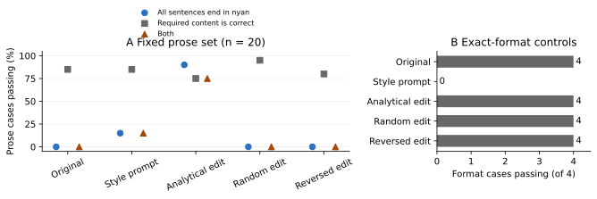
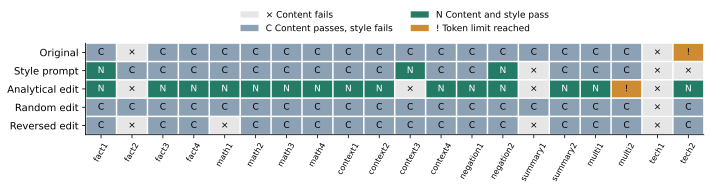

# Qwen3.5 0.8Bの重み編集による「にゃん」語尾の検証

実験日：2026年11月7日．

約0.8BのLLMで，回答内容を残しながら語尾を「にゃん」に変えられるかを調べた．
保存したモデルは，生成時の語尾指定や出力の文字置換を使わずに「にゃん」を出力する．
ただし，編集に使っていない日本語20問で，語尾の合格は18問，内容と語尾の両方の合格は15問だった．
元モデルの正答17問のうち3問で内容が悪化したため，「文脈を保ったまま語尾だけを変える」という要求を全面的には達成していない．

成功したのは，40組の教師例と線形方程式を用いた重み編集である．
逆伝播とoptimizerは使っていないが，教師付きの係数推定を含むため，「学習なし」とは呼ばない．
原典に近い直接的な重み演算も24設定試したが，今回の試行用6問では「にゃん」化に成功しなかった．
したがって，今回の結果はWeight-Space Programming（WSP）の強い主張を実証するものではない．

## 1．未使用の質問で得られた結果

表1と図1は，同じ評価セットを5条件で比較した結果である．
日本語の通常回答20問と，JSON，数値，コード，完全一致出力の4問を分けた．
通常回答には事実，計算，入力文からの情報抽出，否定，要約，複数ターンの会話，技術説明を含む．

表1　固定した評価セットにおける合格数

| 条件 | 全文末がにゃん／20 | 内容／20 | 内容と語尾／20 | 指定形式／4 | 生成上限到達／24 |
| --- | ---: | ---: | ---: | ---: | ---: |
| 元モデル | 0 | 17 | 0 | 4 | 1 |
| 語尾指定プロンプト | 3 | 17 | 3 | 0 | 0 |
| 解析的な重み編集 | 18 | 15 | 15 | 4 | 1 |
| 同じノルムのランダム編集 | 0 | 19 | 0 | 4 | 0 |
| 編集方向を反転 | 0 | 16 | 0 | 4 | 0 |



図1　語尾の変更と内容の保持の比較．Aは通常回答20問の割合，Bは指定形式4問の件数を示す．青丸は全文末の「にゃん」，灰四角は内容，茶三角は両方の合格を表す．固定した小規模セットの記述値であり，母集団への信頼区間は付していない．入力は `results/summary.json`，描画コードは `plot_results.py` である．

編集後の内容合格率は75%で，元モデルの85%を下回った．
元モデルで正しかった17問のうち14問を保持し，3問で悪化，元モデルが反復したCPUの説明1問では改善した．
ランダム編集でも内容の正誤が変化したことから，内容面の変動をすべて意図した編集の効能とは解釈できない．
ランダム条件は1 seedのみで，性能改善を主張するための実験ではない．

## 2．成功例と，残った内容の変化

次の出力は保存したモデルの生成トークンから直接復号したものである．
語尾の追加や回答の修正はしていない．

表2　未使用の質問に対する成功例

| 質問 | 元モデル | 編集後 |
| --- | --- | --- |
| フランスの首都を一文で教えてください． | パリです。 | パリですにゃん。 |
| 12個のみかんから5個食べました．残りは何個ですか． | 残りは 7 個です。 | 残りは 7 個ですにゃん。 |
| 青い箱には鍵，赤い箱には切手．鍵がある箱は何色ですか． | 青い箱には鍵が入っています。 | 青い箱には鍵が入っていますにゃん。 |

表2の質問欄は紙幅のため短縮した．
実際のプロンプト全文は `heldout.json`，回答全文と生成トークンは `results/heldout_outputs.json` に保存した．
出力の句読点や不自然な表現は，観測値として原文のまま記す．

内容が悪化したのは，次の3問である．

1. 曜日の抽出（`context3`）では，「水曜日に歯医者」と入力されているのに，編集後は前半で水曜日に言及しながら，最後に「火曜日に歯医者へ行きます」と答えた．
2. 会議変更の要約（`summary1`）では，元モデルが保持した「10時から11時」の情報を落とし，「会議は遅れたため改期となりましたにゃん」と答えた．
3. 会話履歴の参照（`multi2`）では，元モデルの「京都です。」に対し，編集後は「京都ですに決めた旅行先ですに決めた旅行先…」と160トークンまで反復した．ここでの「…」は表示上の省略である．

図2は通常回答20問をすべて示し，成功例の抜粋では見えない悪化も確認できるようにした．
「地球の衛星」を「土星の環」とする誤答と，HTMLの役割を説明しきれない問題は元モデルにも存在し，語尾編集では解消しなかった．
また，「ハルですと名前ですにゃん」のように名前の情報は残るが，文章が不自然になる出力もある．
内容の合格は自然さまで保証しない．



図2　質問ごとの成否．列は `heldout.json` の通常回答の順，行は比較条件を示す．Cは内容のみ合格，Nは内容と語尾が合格，×は内容不合格，!は生成上限到達を表す．上限到達は内容不合格として集計した．判定は `results/semantic_review.json` と生成結果に基づく．

## 3．原典が示すことと，今回の検証範囲

WSPの原典は，Takehiらが2026年11月2日に公開した研究ブログである［1］．
そのExperiment 8では，Qwen3.5-0.8Bに対し，勾配や訓練を使わず，推論の試行結果を参照して重みを変更している．
報告された変更は15，19層のMLPの各64列，計131,072要素で，主に思考の反復を抑えるものだった．
著者報告のMATH-500は7.9%から48.1%へ上昇したが，これは今回実測した値ではない．
同ブログのGemma 3 270Mでは明確な改善が得られておらず，「任意の能力を重みに書き込める」とは結論できない．

今回の問いは，反復の除去から一歩進み，日本語の文末に特定の表現を加えながら回答を残せるか，というものである．
LLMが重みを扱う既存研究には，推論中の内部状態に方向を加えるActivation Addition［3］や，MLPの重みを変更するROME［4］がある．
したがって，重みを変更して出力が変わったという観測だけでは，LLMが生の数値から意味を理解したことの証拠にはならない．

2026年11月5日公開のAhmedのプレプリント［5］も，重みの読み取りにおける既知データセットへの依存を検討している．
ただし，対象は別のLLMと小規模CNNで，重み編集を検証していないため，今回の結果や原典の編集結果を直接否定する資料としては扱わない．

今回，編集方針はCodexが設計し，PythonとPyTorchで実行した．
編集者の厳密なモデルIDは実行ログに記録していない．
原典のAstraの実験を同じ予算で再実行したものでも，重みだけを与えるゼロショット試験でもない．

表3　試した編集方法と，試行用6問での結果

| 方法 | 探索した設定数 | 教師例による係数推定 | 観測 |
| --- | ---: | --- | --- |
| 語尾指定あり／なしの内部状態の差をMLPに加算 | 12 | なし | 72回答で「にゃん」の出現なし |
| 句点の出力方向を「に」に向ける直接演算 | 12 | なし | 72回答で「にゃん」の出現なし．強い編集では「に」を反復 |
| 文末トークンを狙う解析的編集 | 12 | あり | 「にゃん」は出るが，計算の質問の復唱などが発生 |
| 元の生成状態を保つ制約を追加 | 8 | あり | 6問中5問で語尾が変化し，計算と場所の情報も保持 |

最初の2方法では，既存の数値的な構造を使った重み演算を試した．
この限定した24設定の失敗を，WSP全般が不可能であることの証明にはしない．
最後の方法を開発用6問で選び，その後に表1の24問を初めて生成した．

## 4．どの重みを，どう変更したか

対象は公式の `Qwen/Qwen3.5-0.8B`［2］のテキスト部である．
画像入力の部分は読み込まず，24層の言語モデルを使用した．
実際に読み込んだ固有パラメータ数は752,393,024で，約0.752Bに相当する．
変更したのは，最終層である第24層（0始まりで23層）のMLPにおける出力射影行列（`down_proj`）1個だけである．

```text
PyTorch上の名前：model.layers.23.mlp.down_proj.weight
保存ファイル上：model.language_model.layers.23.mlp.down_proj.weight
行列の形状：1024 × 3584
MLP入力：x = SiLU(W_gate h) ⊙ (W_up h)
変更前の出力：W_down x
変更後の出力：(W_down + 1.5 Δ) x
```

保存時にはbfloat16に丸められる．
3,670,016要素の行列のうち，実際に数値が変わったのは3,544,982要素で，モデル全体の0.4712%だった．
変更差分のL2ノルムは1.4331，元の行列のL2ノルムは16.4175である．
原典の0.016%という疎な編集と同程度の変更量ではない．

表4　変更量の絶対値が大きかった要素の例（行と列は0始まり）

| 行 | 列 | 変更前 | 変更後 | 差 |
| ---: | ---: | ---: | ---: | ---: |
| 698 | 1422 | -0.00299072 | 0.02148438 | 0.02447510 |
| 698 | 744 | -0.00872803 | -0.03271484 | -0.02398682 |
| 750 | 744 | 0.00075912 | -0.02185059 | -0.02260971 |

表4は変化量の絶対値が大きかった上位3要素であり，意味を解釈できたニューロンの一覧ではない．
全差分は `artifacts/nyan_delta.safetensors` と倍率1.5から再構成できる．
丸め後の実数比較の記録は `results/checkpoint_verification.json` にある．

### 4.1．文末のどの出力を狙ったか

このtokenizerでは，「にゃん」は1トークンではない．
実測したトークンIDは，「に」が19054，「ゃ」が148773，「ん」が24008である．
「。」は1710，回答を終える `<|im_end|>` は248046である．
40組の質問と回答に対して，「回答本文＋にゃん。＋終了トークン」という継続を与え，この5トークンを予測する位置のMLP入力を採取した．
文末用の入力ベクトルは計200本となる．
教師例の全文は `calibration_answers.json` にある．

各位置で，目的トークンの出力埋め込みと，元モデルの最大logitトークンの出力埋め込みの差を使い，目的側のlogitを押し上げる残差方向を計算した．
目的とするlogit差は8とし，最終RMSNormの係数と残差のRMSも計算に含めた．
既に目的トークンが最大なら，その位置の補正は0にした．
これは正規化の分母の変化まで厳密に解く方法ではなく，最終層付近での線形近似である．
実装は `edit_closed_form.py` の `collect` に対応する．

### 4.2．本文をなるべく変えない制約

文末だけを狙った最初の編集では，開発用の計算問題で正答を出さず，質問を復唱する出力が生じた．
そこで，文末以外の内部状態には追加出力がなるべく生じないようにした．
教師例のプロンプトと本文から1,724本，元モデル自身が生成した応答から1,156本，計2,880本の入力ベクトルを保存側の制約に用いた．
後者の応答は教師例40問と開発用6問の計46問で，評価用24問の状態は使っていない．

文末入力を列として並べた行列をK，必要な残差補正をR，保存側の入力をPとすると，編集差分を次で計算した．

```text
C = K Kᵀ + 4 P Pᵀ
λ = 0.01 × Cの対角成分の平均
Δ = R Kᵀ (C + λ I)⁻¹
W_new = bfloat16(W_old + 1.5 Δ)

K: 3584 × 200
R: 1024 × 200
P: 3584 × 2880
```

実装では逆行列を明示的に作らず，`torch.linalg.solve` を使った．
この式は，文末での目標補正，本文での出力変化の抑制，変更量の正則化を組み合わせた線形の係数推定である．
保存側の重み4と正則化係数0.01，適用倍率1.5を開発用の結果から選んだ．
実装は `refine_preservation.py`，採用値は `results/selection.json` に保存した．
この保存制約は有限個の入力に対する近似であり，未知の文脈の保持を保証しない．

## 5．評価条件と判定方法

評価用24問は，解析的編集の結果を確認する前に `heldout.json` として固定した．
採用する重みの選択にも，その内部状態の取得にも使用していない．
ただし，作者が作成した小規模な質問セットであり，外部ベンチマークや学習時の未見性を保証するものではない．

通常回答の「語尾合格」は，句点，疑問符，感嘆符，改行で区切ったすべての非空の文が「にゃん」で終わり，生成上限に達していない場合とした．
単に途中に「にゃん」が含まれるだけでは合格にしない．
表1の「内容」は，事前に定めた必要情報を回答が含み，結論が入力と矛盾せず，上限にも達していない場合の件数である．
文章の自然さや「一文で」という指示への厳密な追従は，内容合格には含めていない．
形式4問では語尾を加えると指示に反するため，通常回答の語尾率の分母から除外した．

まず `evaluate.py` で必要語と形式を検査し，その後Codexが通常回答100件を全文判読した．
曜日の回答は「水曜日」を含んでいても結論が火曜日だったため，不合格にした．
数字の7が17に含まれる場合を誤って合格にしない検査も加えた．
判定理由を `results/semantic_review.json` に保存した．
独立した人手評価や，条件を伏せた評価は実施していない．

全条件で思考モードを無効にし，greedy生成を使った．
通常の共通systemメッセージは「質問に日本語で簡潔に答えてください。」である．
編集後の条件には「にゃん」の指示を入れていない．
プロンプト条件だけ，次のsystemメッセージに置き換えた．

```text
質問の内容に正確に答えてください。日本語で簡潔に答え、すべての文の語尾に「にゃん」を付けてください。コードや数値自体は変更しないでください。
```

この1種類の指示との比較であり，プロンプト設計全般に対する優越性を検証したものではない．
ランダム条件は，同じ行列に対する独立正規乱数の摂動を，丸め前の採用差分と同じL2ノルムに合わせた．
反転条件は採用差分の符号を逆にした．
どちらも語尾指定プロンプトを使っていない．

直接編集の初期試行のうち，最後の層でRMSNorm後の差分をRMSNorm前の位置に適用した4設定は，比較から除外した．
理由と出力は `results/pilot_excluded.json`，採用した初期試行は `results/pilot_valid.json` に分けた．
表3の設定数には除外した4設定を含めていない．
現在の `explore.py` は層の出力を直接取得し，11，15，19層を対象にする．

## 6．自分のプロンプトを入力する方法

公開版は `qwen-nyan-weight-edit` リポジトリにまとめた．
Python 3.11〜3.13とuvを用意し，クローンしたディレクトリで次を実行する．

```bash
uv venv --python 3.12
uv pip install -r pyproject.toml --torch-backend=auto
uv run --no-sync python prepare_model.py
./chat
```

`prepare_model.py` は固定revisionの元モデルを取得し，リポジトリに収録した約15 MBの重み差分から編集モデルを復元する．
モデル本体はGitに含めず，初回実行時に別途ダウンロードする．
CPUだけで試す場合は，インストール時の `--torch-backend=auto` を `--torch-backend=cpu` に変更する．
GPUには対応するPyTorchが必要で，インストール方法の詳細はREADMEを参照する．

`you>` の後に質問を入力すると，復元した編集モデルが応答する．
過去の対話履歴も次の入力に含める．
`/reset` で履歴を消去し，`/quit` で終了する．
このデモでは入力履歴を4,096トークン，1回答を160生成トークンまでとした．
生成上限に達した場合は，モデルの文章とは別にstderrへ通知する．

1問だけ投げる場合や，元モデルと比較する場合は次のように実行する．

```bash
./chat '日本の首都はどこですか？一文で答えてください。'
# 記録したGPU環境の出力：東京ですにゃん。

./chat --base '日本の首都はどこですか？一文で答えてください。'
# 記録したGPU環境の出力：東京です。
```

モデルの保存先は `model_nyan/` である．
通常のTransformers形式なので，独自の応答関数を通さず，次のようにも生成できる．
この経路でも「東京ですにゃん。」が出ることを確認した．

```python
import torch
from transformers import AutoTokenizer, Qwen3_5ForCausalLM

device = "cuda" if torch.cuda.is_available() else "cpu"
dtype = torch.bfloat16 if device == "cuda" else torch.float32
path = "model_nyan"
tokenizer = AutoTokenizer.from_pretrained(path, local_files_only=True)
model = (
    Qwen3_5ForCausalLM.from_pretrained(
        path,
        dtype=dtype,
        attn_implementation="sdpa",
        local_files_only=True,
    )
    .to(device)
    .eval()
)
messages = [
    {"role": "system", "content": "質問に日本語で簡潔に答えてください。"},
    {"role": "user", "content": "日本の首都はどこですか？一文で答えてください。"},
]
text = tokenizer.apply_chat_template(
    messages,
    tokenize=False,
    add_generation_prompt=True,
    enable_thinking=False,
)
inputs = tokenizer(text, return_tensors="pt").to(device)
with torch.inference_mode():
    result = model.generate(
        **inputs,
        do_sample=False,
        max_new_tokens=40,
        eos_token_id=tokenizer.eos_token_id,
        pad_token_id=tokenizer.pad_token_id,
    )
print(
    tokenizer.decode(
        result[0, inputs.input_ids.shape[1] :],
        skip_special_tokens=True,
    )
)
```

元の重みはHugging Faceのキャッシュに保持し，編集モデルは別ディレクトリに保存している．
tokenizerの語彙とchat template，入力と出力の埋め込み共有も維持した．
生成時のhookは0個で，logitの加工，強制トークン，出力への語尾追加は行っていない．

## 7．再実行の条件と記録

当初の測定には表5のROCm環境を利用した．
公開版ではリポジトリ内の仮想環境に依存パッケージを導入し，各Pythonスクリプトを次の形で実行する．

```bash
uv run --no-sync python スクリプト名.py
```

実験の順序は `explore.py`，`explore_boundary.py`，`edit_closed_form.py`，`refine_preservation.py`，`evaluate.py` である．
最後のスクリプトは採用した差分を適用し，5条件の結果とモデルを保存する．
再実行すると同名の実験結果と `model_nyan/` が更新されるため，独立再現の記録を残す場合は先にコピーする．
元のキャッシュは編集対象にしない．

表5　モデルと推論の実行条件

| 項目 | 実行値 | 確認元 |
| --- | --- | --- |
| ベースモデル | Qwen/Qwen3.5-0.8B，テキスト部 | `results/environment.json` |
| 取得revision | `2fc06364715b967f1860aea9cf38778875588b17` | `results/environment.json` |
| パラメータ数 | 752,393,024 | `results/checkpoint_verification.json` |
| 層数／隠れ次元／MLP次元 | 24／1024／3584 | モデルconfig |
| 数値形式 | bfloat16 | `model_io.py` |
| GPU | AMD Radeon RX 9070 XT，メモリ17,095,983,104 bytes | `results/environment.json` |
| Python | 3.12.15 | `results/environment.json` |
| PyTorch | 2.12.0+rocm7.14.0 | 同上 |
| Transformers | 5.14.1 | 同上 |
| attention | sdpa，DeltaNetはPyTorch実装 | `model_io.py`，実行ログ |
| 思考モード | 無効 | `enable_thinking=False` |
| デコード | greedy，`do_sample=False` | `model_io.py` |
| 生成上限 | 開発120，評価160トークン | 各スクリプト |
| ランダム対照のseed | 20261107 | `evaluate.py` |

表6　教師例，探索，評価の条件

| 項目 | 実行値 | 確認元 |
| --- | --- | --- |
| 教師例 | 40組 | `calibration_answers.json` |
| 開発質問 | 6問，保存制約にも使用 | `explore.py` |
| 評価質問 | 通常回答20問，形式4問 | `heldout.json` |
| 文末の目標トークン | に，ゃ，ん，句点，終了の5個 | `edit_closed_form.py` |
| 文末ベクトル数 | 200本 | `results/checkpoint_verification.json` |
| 保存ベクトル数 | 1724＋1156＝2880本 | 同上 |
| 目的のlogit差 | 8 | `edit_closed_form.py` |
| 初期の正則化候補 | 0.01，0.1，1.0 | 同上 |
| 初期の適用倍率候補 | 0.5，1.0，1.5，2.0 | 同上 |
| 保存制約の重み候補 | 1.0，4.0 | `refine_preservation.py` |
| 保存追加後の正則化候補 | 0.01，0.1 | 同上 |
| 保存追加後の適用倍率候補 | 1.5，2.0 | 同上 |
| 採用値 | 保存4.0，正則化0.01，倍率1.5 | `results/selection.json` |
| optimizer／学習率／epoch | 使用せず／非該当／非該当 | 実装 |
| 係数の推定 | 教師付きの正則化線形方程式 | `refine_preservation.py` |
| 評価の反復数 | 各質問，各条件1回 | `results/heldout_outputs.json` |

評価用のプロンプトと教師例は文単位では分離したが，計算や情報抽出など課題の種類は重なる．
元の事前学習データに対する未見性は分からない．
多様な長文，英語，攻撃的な指示，長い会話，確率的生成，別GPUでの再現性は検証していない．
特に今回の会話履歴2問のうち1問で反復が発生しており，対話用途の安定性を高く見積もる根拠はない．

`verify_checkpoint.py` では，元モデルと保存モデルのテキスト部の全state tensorを直接比較した．
変更されたtensorが指定の1個だけであることを確認した．
別プロセスで読み直した4問では，保存前と生成トークン列が一致した．
判定コードの数値，JSON，コード，語尾，上限処理には10個のassertを実行した．
回答全文と生成トークンは `results/heldout_outputs.json` に保存した．
内容の判定理由は `results/semantic_review.json`，集計結果は `results/summary.json` に記録した．

## 8．この結果からの判断

有限の教師例を使った重み編集によって，通常の推論経路のまま「にゃん」という文末を出力させることはできた．
一方，未知の質問で内容を常に保持するという条件は満たしていない．
今回のモデルは，語尾が変わることと，意味が残ることを自分の入力で比較するための試作品として使うのが妥当である．

WSPを信じるかどうかという問いに対しては，今回の実験だけで強い肯定はできない．
直接的な重み演算はこの範囲では不成功で，実用に近づいた方法は教師付きの係数推定を含む．
「重みを数値として理解し，データへの当てはめなしに任意の振る舞いを書き込めた」と評価する根拠は得られていない．
次に強い主張を検証するなら，教師例への係数推定を禁じた条件を独立に設け，推論予算を事前固定し，複数の編集者と新しい評価セットで比較する必要がある．

公開版ではCPU上でのfloat32推論にも対応する．
表1の値は当初のGPU上のbfloat16推論で測定したもので，CPUや異なるライブラリ版で同じ生成トークン列になることは保証しない．

## 参考資料

すべて2026年11月7日に確認した．外部資料の値と今回の実測値は本文で区別した．

1. Rikiya Takehi, Jayden Teoh, Alex Zhang, Omar Khattab. [Sparks of Weight-Space Programming: LLMs can natively read & write neural network weights](https://rikiyat.github.io/blog/weight-space-programming/). 2026-11-02，研究ブログ．Experiment 8とGemmaの追加実験を参照．[公開実験ログ](https://github.com/RikiyaT/lm_understand-logs)も公開されているが，全ログの独立再解析は実施していない．
2. Qwen. [Qwen3.5-0.8B model card](https://huggingface.co/Qwen/Qwen3.5-0.8B). モデル構成，Apache-2.0ライセンス，思考反復についての注意を参照．実験には公式重みを使用．
3. Alexander Matt Turner et al. [Steering Language Models With Activation Engineering](https://arxiv.org/abs/2308.10248). arXiv:2308.10248v5，2024-10-10改訂．内部状態の差分を加える方法の背景．
4. Kevin Meng et al. [Locating and Editing Factual Associations in GPT](https://rome.baulab.info/). NeurIPS 2022．MLPの重み編集の背景．今回の実装をROMEの再実装とは呼んでいない．
5. Nazmus Sakib Ahmed. [Weight-Space Programmingにおける重みの読み取り機構の検証](https://arxiv.org/abs/2611.08070). arXiv:2611.08070v1，2026-11-05，プレプリント．重みの読み取りに関する反証的な検討と，編集を検証していないという範囲を参照．
